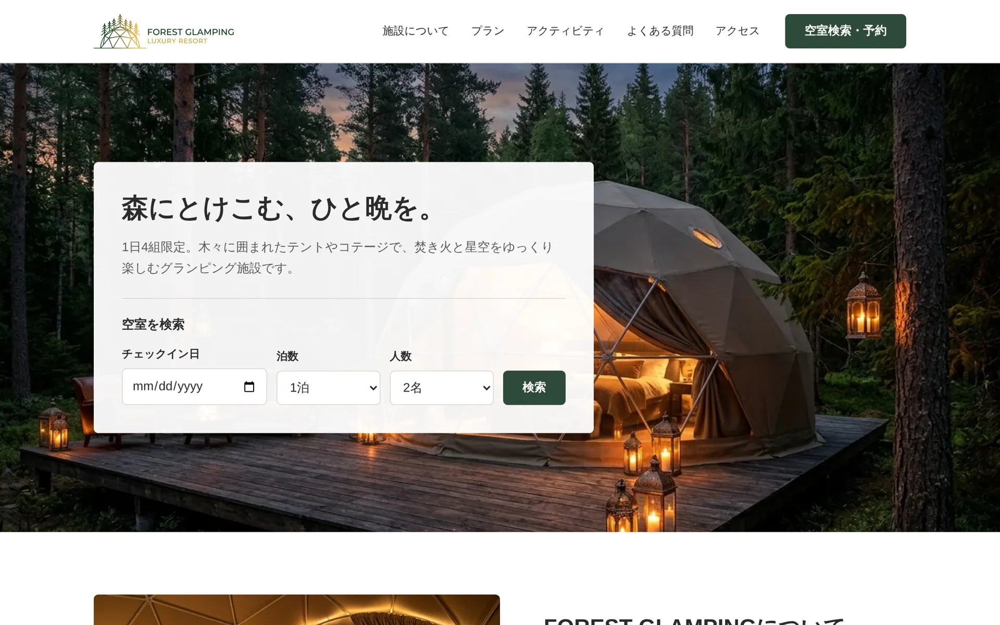
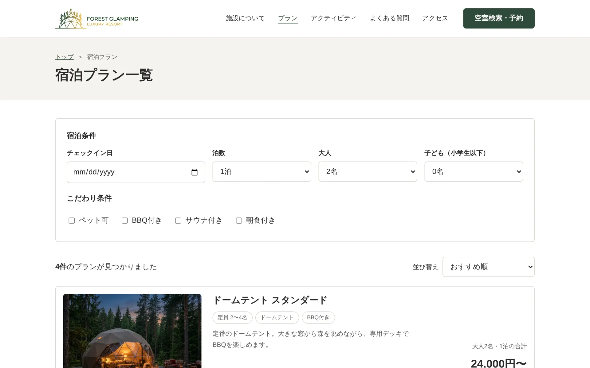
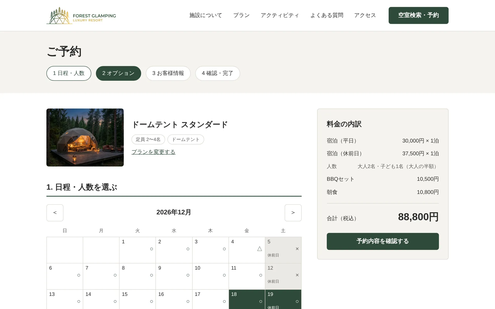
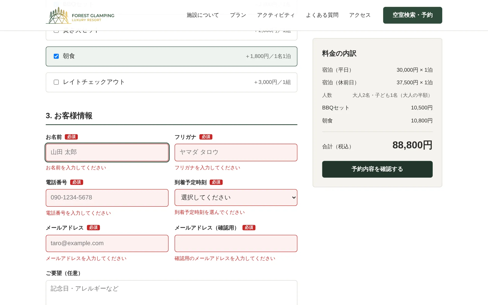
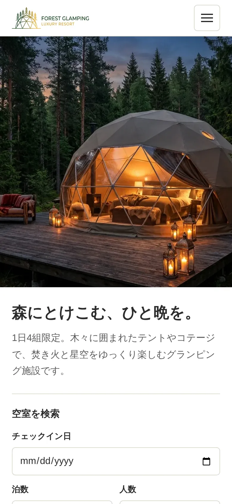
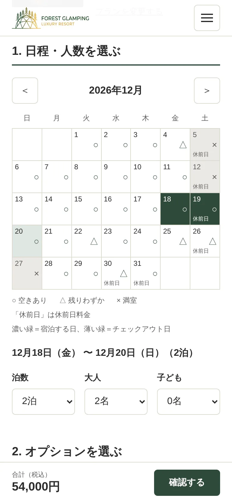
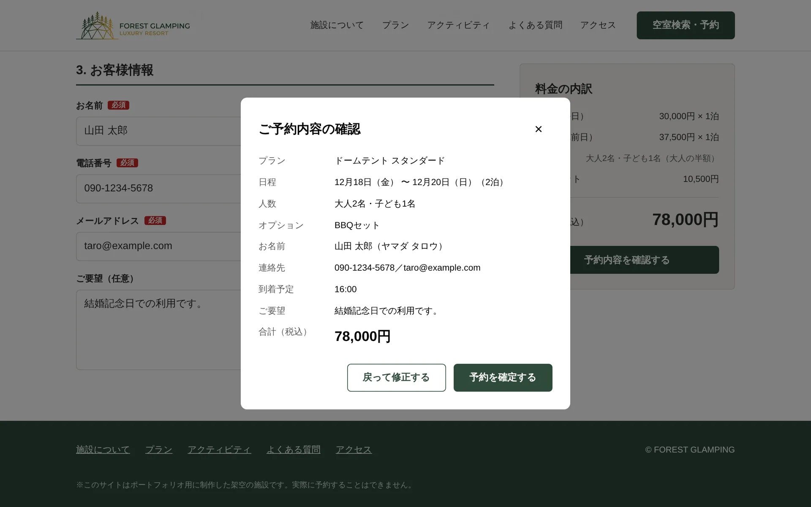
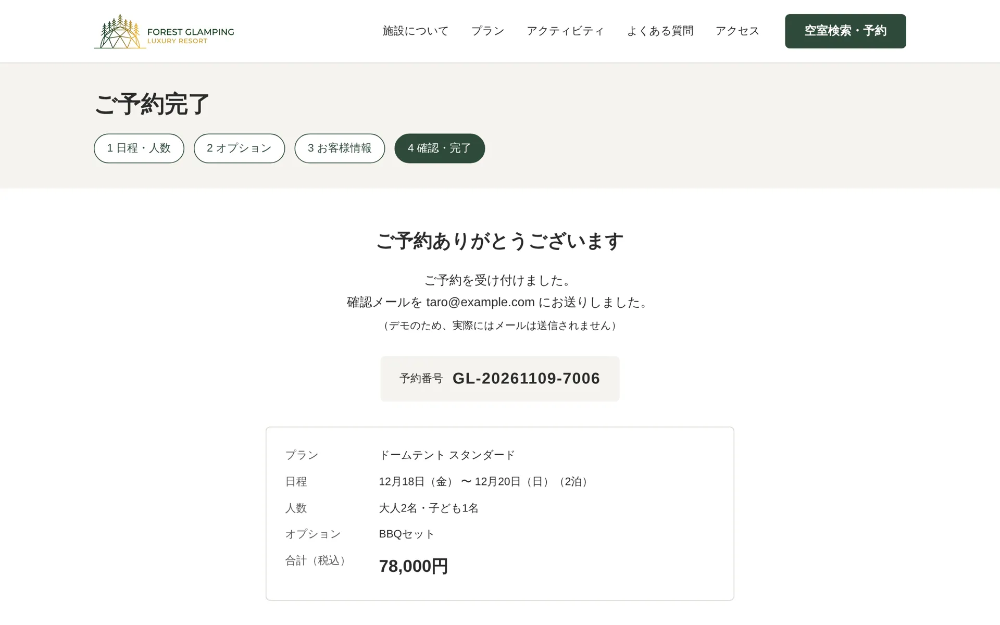

# FOREST GLAMPING ― グランピング施設の予約サイト

森の中のグランピング施設（架空）を題材にした、予約サイトのフロントエンドです。
トップページ → プラン一覧（検索・絞り込み）→ 予約（日程・オプション・お客様情報）→ 確認 → 完了 までの流れを、Vue 3 と TypeScript で作りました。

> ※ ポートフォリオ用に制作した架空の施設です。実際に予約することはできません。

**公開URL：** https://glamping-vue.vercel.app



---

## 主な機能

| 画面 | できること |
| --- | --- |
| トップ | 空室検索（条件をURLに付けてプラン一覧へ）、よくある質問の開閉、スマホ用メニュー |
| プラン一覧 | 人数・こだわり条件（ペット可・BBQ付き など）での絞り込み、料金順・定員順の並べ替え、条件をURLに保存（再読み込み・共有しても同じ結果） |
| 予約 | 空き状況カレンダー（空きあり・残りわずか・満室・休前日）、泊数・人数の選択、定員オーバーと満室日のチェック、オプション選択、料金の自動計算（平日・休前日・子ども料金・オプション） |
| お客様情報 | 入力チェック（必須・カタカナ・電話番号・メール形式・確認用メールの一致・文字数）、エラーの項目へカーソル移動 |
| 確認・完了 | 確認ポップアップ（`<dialog>`）、送信中の二重送信防止、予約番号の発行、完了ページ |

<table>
  <tr>
    <td></td>
    <td></td>
  </tr>
  <tr>
    <td align="center">プラン一覧（絞り込み・並べ替え）</td>
    <td align="center">予約ページ（カレンダー・料金の内訳）</td>
  </tr>
  <tr>
    <td></td>
    <td>
      
      
    </td>
  </tr>
  <tr>
    <td align="center">お客様情報の入力チェック</td>
    <td align="center">スマホ表示</td>
  </tr>
  <tr>
    <td></td>
    <td></td>
  </tr>
  <tr>
    <td align="center">予約内容の確認ポップアップ</td>
    <td align="center">予約完了ページ（予約番号の発行）</td>
  </tr>
</table>

---

## 使用技術

| 分類 | 技術 |
| --- | --- |
| フレームワーク | Vue 3（Composition API・`<script setup>`） |
| 言語 | TypeScript |
| ルーティング | Vue Router |
| 状態管理 | Pinia（予約の送信と完了データ） |
| ビルド | Vite |
| スタイル | CSS（CSS変数・BEM、ライブラリは使わず手書き） |
| コード整形 | Prettier |
| 公開 | Vercel |

---

## 工夫した点

### 1. 作る順番を決めて進めた
ワイヤーフレーム → HTML → CSS → Vue の順で作りました。
先に静的なHTML/CSSで見た目と構造を固めてから、動きの部分を Vue に置き換えています。

### 2. 計算やチェックを画面から切り離した
料金の計算（`src/utils/price.ts`）と入力チェック（`src/utils/validate.ts`）は、画面に関係しない関数にしました。
テストがしやすく、あとで PHP 側にも同じルールを書くときに移しやすくしています。

### 3. 条件をURLに持たせた
プラン一覧の検索条件や、予約ページの日程・人数は URL のクエリに保存しています。
再読み込みしても入力が消えず、URLを共有すれば同じ画面を開けます。

### 4. 共通の処理をまとめた
JSONの取得（読み込み中・エラーの状態を含む）は `useJsonData` という composable にまとめ、
プラン・空き状況・オプションの取得で使い回しています。

### 5. 使いやすさとアクセシビリティ
- エラーは「その項目から離れたとき」か「確認ボタンを押したとき」に表示し、入力中にいきなり赤字が出ないようにした
- エラーがある項目へカーソルを移動し、`aria-invalid`・`aria-describedby` でエラー文と入力欄を結びつけた
- よくある質問の開閉ボタンに `aria-expanded`、カレンダーの日付に読み上げ用のラベルを付けた
- 完了ページへは `router.replace` で移動し、「戻る」で予約ページに戻って二重予約しないようにした

---

## ディレクトリ構成

```
src/
├── views/          ページ（トップ・プラン一覧・予約・完了）
├── components/     部品（ヘッダー・カレンダー・確認ポップアップ・FAQ など）
├── composables/    データ取得の共通処理（useJsonData・usePlans など）
├── stores/         Pinia のストア（予約）
├── utils/          計算・チェック・日付などの関数
├── types/          型の定義
├── router/         ルーティング
└── assets/         CSS
public/
├── data/           モックデータ（プラン・空き状況・オプション）
└── images/         画像
```

---

## データについて

API はまだないため、`public/data/` の JSON をモックとして読み込んでいます。

- `plans.json`：プラン（料金・定員・特徴・残り室数）
- `availability.json`：空き状況と祝日（2026年11月〜2027年3月分）
- `options.json`：オプション（BBQセット・朝食 など）

予約の送信も、今は少し待ってから成功したことにしています（`src/stores/reservation.ts`）。

---

## 今後の予定

- PHP で API を作り、MySQL に予約を保存する（JSONの読み込みと送信を、本物の API に置き換える）
- 予約を確認・管理する管理画面を作る
- 料金計算と入力チェックのテスト（Vitest）を書く

---

## ローカルでの起動方法

```sh
npm install
npm run dev      # 開発用サーバー（http://localhost:5173）
npm run build    # 型チェック＋本番用ビルド
npm run preview  # ビルドした結果を確認
```
